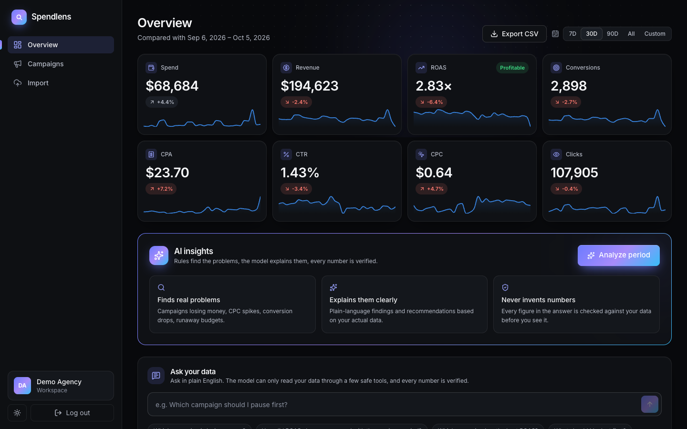
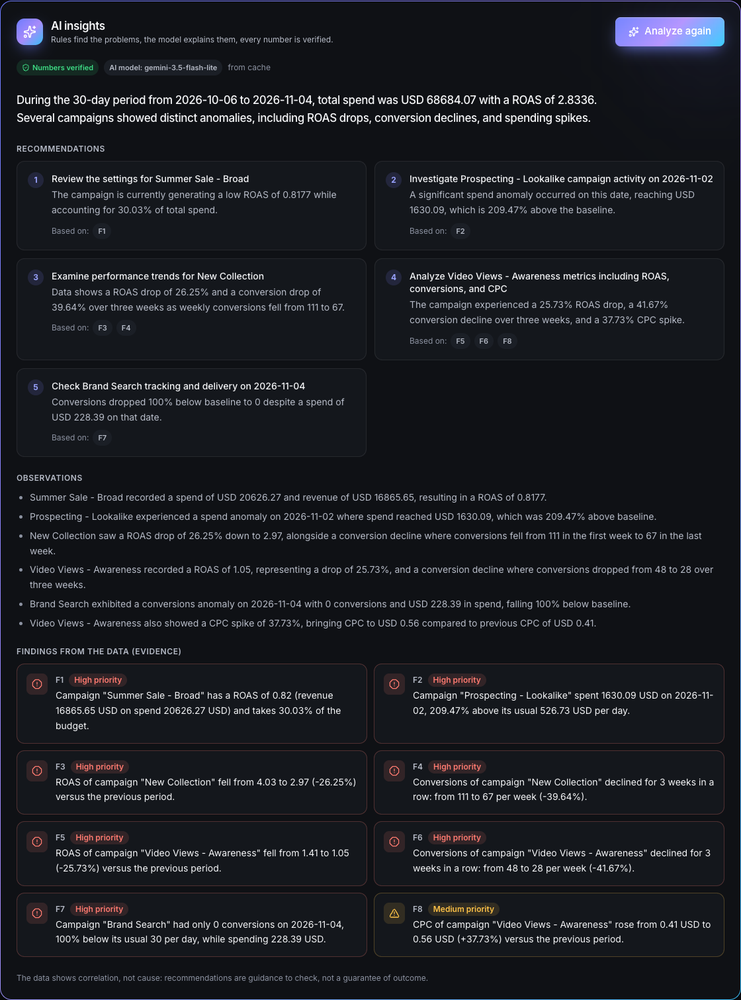
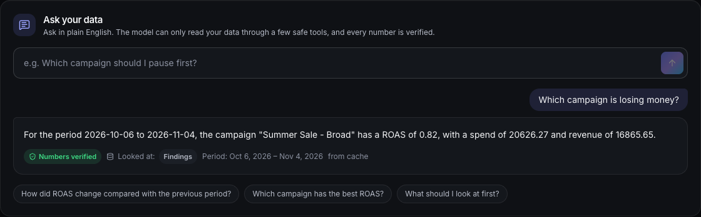

# Spendlens

**Marketing analytics platform with verified AI insights.** Import ad campaign data, see where the budget leaks, and get
plain-language findings and recommendations in which every number is checked against your data before you see it.



## What it does

| | |
|---|---|
| **Import** | CSV upload with **automatic recognition of Meta Ads and Google Ads exports** (title lines, `Total` rows, currency symbols, thousands separators, `--`), a one-time column mapping that is remembered per file layout, per-row error reports (row, column, reason) and idempotent re-imports. Handles `;` and tab separators, decimal commas, BOMs and UTF-16. Breakdown rows (by country, device...) of the same ad and day are summed; files with totals for a whole period and no date column are spread evenly over a chosen period. Import history with deletion of an import's data. |
| **Overview** | Spend, revenue, ROAS, conversions, CPA, CTR, CPC and clicks, each compared with the previous period and shown with a trend line. |
| **Campaigns** | Search, sort by any metric, per-campaign details (ad sets and ads), side-by-side comparison of up to four campaigns, CSV export protected against formula injection. |
| **AI insights** | A deterministic rules engine finds the problems (campaign losing money, CPC spike, conversion decline, runaway budget, broken tracking). An LLM explains them. |
| **Ask your data** | Plain-English questions answered through function calling over a few read-only, workspace-scoped tools. |
| **Multi-tenant** | Every workspace is isolated; each route is covered by isolation tests. Workspace settings (name, currency, target ROAS). |

| AI insights | Ask your data |
|---|---|
|  |  |

## How the AI is kept honest
The model never discovers problems and never sees the database.

1. **Rules decide what is a problem** (`server/src/modules/ai/findings.ts`): every threshold is a named constant. Anomalies use a robust z-score (median and MAD) against a rolling baseline.
2. **The model only words the findings**, receiving aggregates, never raw rows, and answers in a strict JSON schema.
3. **Every answer is verified** before it is shown: each number must exist in the input data, recommendations must cite existing findings, and causes may not be stated as fact. One corrective retry is allowed.
4. **If verification fails, or the model is unavailable, rate-limited or not configured, the rule-based findings are shown instead.** The user is never shown an invented figure.
5. **"Ask your data" uses tools, not SQL.** The workspace comes from the verified token and is not a tool argument; arguments are validated; the final answer goes through the same verification.

## Problems it detects
Every rule is deterministic with named thresholds (`server/src/modules/ai/findings.ts`) and only reports campaigns that take at least 5% of the spend.

| Finding | Fires when |
|---|---|
| Losing money | ROAS below 1 |
| Spend without conversions | 30+ clicks and not a single conversion (replaces "losing money" for that campaign) |
| Below target ROAS | profitable, but under the **target ROAS the user set** in Settings (1 = break-even only) |
| High CPC / CPC spike | CPC 30% above the account average / 30% up versus the previous period |
| Low CTR | CTR below half of the account average (10,000+ impressions) |
| ROAS drop | ROAS 25% down versus the previous period |
| Conversion decline | three complete weeks in a row, 20% or more in total |
| Spend anomaly / conversions anomaly | one of the last 3 days far from the previous 14 days (runaway budget / possible broken tracking) |
| Top performer | ROAS 1.5x above the account average (an opportunity) |

## Evaluation
The AI layer is measured, not assumed (`server/evals`): synthetic accounts with known correct answers, a labeled corpus of defective model answers for the validator, an LLM judge calibrated on deliberately bad answers, model comparison and an evaluation of the tool-using flow. Each metric has a pass/fail gate and the commands exit non-zero on failure, so they fit in CI.

```bash
npm run eval                   # offline and deterministic (also part of `npm test`)
npm run eval:llm -- --judge    # real model: grounded numbers, injection resistance, writing quality
npm run eval:compare -- --models gemini-3.5-flash-lite,gemini-3.1-flash-lite
npm run eval:ask               # tool choice, answer correctness, refusals
```
Measured so far (synthetic data, `gemini-3.5-flash-lite`): rule findings 100% precision and 100% recall on 16 labeled scenarios; the validator catches 13 of 13 defective answers with no false rejects; the quality judge ranks a solid answer 5/5 against 1 to 2.2 for deliberately bad ones; the model's answers had 100% grounded numbers and 100% resistance to prompt injection; "Ask your data" chose the right tools for 14 of 14 questions, with every answer verified and every off-topic or prompt-leak request refused. The model comparison is still to be run (the free daily quota of the larger models was used up).

The free Gemini tier allows 15 requests per minute per model and 20 per day for the larger Flash models, so the evaluation paces its calls.

## Stack
- **Backend:** Node.js, Express 5, TypeScript, Sequelize, PostgreSQL, Zod, JWT + bcrypt, Swagger, Jest + Supertest
- **Frontend:** React, Vite, Tailwind CSS, shadcn-style components, Recharts, TanStack Query
- **AI:** Google Gemini (model chain with retries, quota-aware backoff and a rules-only fallback) behind a provider interface
- **Infra:** Docker Compose (PostgreSQL, API, nginx serving the React build)

## Run it

### Full stack with Docker
```bash
cp .env.example .env          # set JWT_SECRET (at least 32 characters) and optionally GEMINI_API_KEY
docker compose up --build -d  # postgres + server + client (nginx)
docker compose run --rm server node dist/database/seed.js   # optional: demo data
```
The app is on http://localhost:8080 (Swagger at `/api/docs`); demo login `demo@spendlens.dev` / `demo12345`.
The server applies migrations on every start. Stop with `docker compose down` (`-v` also removes the data).

### Development
```bash
cp .env.example .env
npm install
npm run db:up        # PostgreSQL in Docker (also creates the spendlens_test database)
npm run db:migrate
npm run db:seed      # demo data: 90 days, 6 campaigns with planted problems
npm run dev:server   # http://localhost:4750/api/health
npm run dev:client   # http://localhost:5173
npm test             # 170+ tests against the spendlens_test database
```
Without `GEMINI_API_KEY` only the rules layer runs (free key: https://aistudio.google.com/apikey).

Sample CSV files for every import scenario (valid, with errors, European format, a Meta-style export that needs mapping, a 30,000-row file) are in [`samples/`](samples/README.md). How the importer behaves on real public datasets is described in [`samples/public-datasets.md`](samples/public-datasets.md).

## Configuration
| Env | Meaning |
|---|---|
| `JWT_SECRET` | signing secret, at least 32 characters |
| `GEMINI_API_KEY` | optional; enables the LLM layer |
| `GEMINI_MODELS` | model chain in priority order (default `gemini-3.5-flash-lite,gemini-3.8-flash`) |
| `AI_RATE_LIMIT_PER_HOUR` / `AI_CACHE_TTL_MINUTES` | per-workspace AI call limit and answer cache lifetime |
| `AUTH_LOGIN_LIMIT` / `AUTH_IP_LIMIT` | failed logins per IP+email / auth requests per IP, per 15 minutes |
| `TRUST_PROXY_HOPS` | reverse proxies in front of the server (0 = none; Compose sets 1) |

## Project structure
```
server/src
  config/        validated environment
  middleware/    auth (token + workspace membership), rate limiting, error handling
  modules/       auth, workspaces, imports, analytics, campaigns, exports, ai (+ ask)
  database/      Sequelize models, umzug migrations, seed
server/evals     AI evaluation suites
client/src       React app (pages, components, hooks, lib)
samples/         sample CSV files
```

## Status and limitations
Built as an MVP and suited to a supervised pilot. Not yet in place: password reset, multiple users and workspaces per account,
automatic data connectors (Meta/Google Ads), and a privacy setup for sending client data to a paid LLM tier.
The AI evaluation uses synthetic data; behavior on real accounts still has to be validated.
